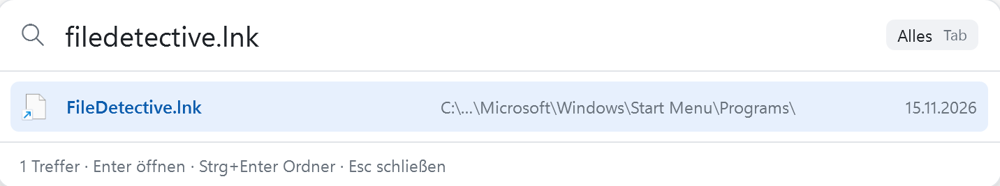

# FileDetective

Find files and folders by name in milliseconds, on your local drives and on connected network shares.

FileDetective is a small Windows tray program. Press **Alt+Space** from any program, type a few words, hit Enter. It keeps a
compact index of file and folder **names** in memory and searches it as you type. It reads names only, never the content
of your files.

<!-- Screenshot: put a picture of the search bar at docs/screenshot.png and uncomment the next line.

-->
*(Screenshot follows.)*

- Windows 10 (version 2004) or Windows 11, 64-bit. No administrator rights, no .NET installation needed.
- Free software under the MIT license. No telemetry, no account, no ads.
- The only connection to the internet is an optional once-a-day check for a new version (see [Updates](#updates)).

## Download

Get the latest version from the [Releases page](https://github.com/christophfetz/FileDetective/releases/latest).
Each release has two downloads:

| File | What it is |
|---|---|
| `FileDetective-<version>-win-x64-setup.exe` | Installer. Installs for the current user only (no administrator rights) into `%LOCALAPPDATA%\Programs\FileDetective`, adds a Start menu entry and offers to start FileDetective with Windows. |
| `FileDetective-<version>-win-x64.zip` | The single `FileDetective.exe` with license, readme and changelog. Unpack it anywhere you can write to and run it. Nothing is installed. |

`SHA256SUMS.txt` lists the checksums of both files. To check a download, run in PowerShell:
`Get-FileHash .\FileDetective-<version>-win-x64.zip -Algorithm SHA256`, and compare the result with the file.

Both downloads contain the .NET runtime (the exe is about 75 MB). The single exe unpacks a few native libraries into
`%TEMP%\.net` at its first start.

### SmartScreen warning

The program is **not code-signed** (a certificate costs money and is not planned). Windows SmartScreen therefore shows
"Windows protected your PC" the first time you run the download. Click **More info**, then **Run anyway**. You can compare
the SHA-256 checksum with `SHA256SUMS.txt`, and you can read and build the source code yourself.

## Using it

At the first start a window asks which places to include. Your user folder is selected. Network shares are only included
if you tick them. After that FileDetective runs quietly in the notification area (tray icon).

| Key | Effect |
|---|---|
| **Alt+Space** | Show or hide the search bar from anywhere (changeable in the settings) |
| *typing* | Search. Several words in any order, all must appear in the name or the path. Upper/lower case does not matter, `müller` finds `Mueller`. |
| `.pdf` | A word like `.pdf` filters by file type: `invoice .pdf` |
| `"two words"` | Quotes keep words together |
| **Tab** / **Shift+Tab** | Switch between All, Files and Folders |
| **Up/Down**, **PgUp/PgDn** | Move the selection |
| **Enter** or double click | Open |
| **Ctrl+Enter** | Show in Explorer |
| **Ctrl+C** | Copy the full path (when no text in the box is selected) |
| **Right click** | Menu: Open, Show in Explorer, Copy path |
| **Esc** | Close |

With an empty box the bar shows what you opened through it most recently. Hits are ranked: all words in the name first,
then names that start with your first word, then items you opened before, then the newest.

The tray icon menu has *Search*, *Update now* (read all places again), *Settings* and *Exit*. In the settings you can change
the places, the exclusions, the shortcut, the language (Windows language, German or English), the update check and how
gently network shares are treated, and you can rebuild the whole index.

By default FileDetective skips system folders and developer clutter: `node_modules`, `.git`, `Windows`, `Program Files`,
`ProgramData`, `AppData`, the recycle bin and similar, plus temporary files. The lists are editable.

## What happens on network shares, and what does not

This is the part to show your IT department.

- On shares FileDetective **only lists folders** (the same thing Explorer does when you open a folder). It **never opens a
  file** there, not for icons, not for previews, not for checksums. File icons come from the file extension alone.
- It **never writes** to any place it searches. All its own data lives in `%LOCALAPPDATA%\FileDetective`.
- A share is read with **exactly one connection at a time**, with a pause after each folder as long as the folder took to list
  (at most 250 ms). A slow server therefore makes it slower, not busier. "Very gentle" mode pauses four times as long.
- A share is read **at most once per day automatically** (when the last complete scan was on an earlier day and the share is reachable), plus when you click
  *Update now*. A cancelled scan is retried at most three times per day.
- Local places are kept current while the program runs (file system notifications), without any polling.
- If a folder cannot be read (permissions, network trouble), FileDetective **keeps what it knew** about that folder. Entries
  are only removed when a folder was read completely and the item is really gone.
- If a share is not connected, its hits stay visible, greyed out and marked "not connected". Opening the search bar never waits
  for a dead share.
- The log (`filedetective.log`) records for every scan how many folders and entries were read, how long it took, the sum
  of the pauses and the number of errors.
- Nothing is ever deleted by FileDetective. It has no delete function.

## Where your data lives

Everything is in `%LOCALAPPDATA%\FileDetective` (the *Settings > About* page has a button to open it):

| File | Content |
|---|---|
| `index.db` | The index of names (SQLite) and the list of items you opened |
| `settings.json` | Your settings |
| `filedetective.log`, `.old` | Log, at most about 2 MB |
| `update-state.json`, `update\` | Day of the last update check, temporary update download |

The index is built from your files' names and paths, so treat `index.db` like your file listing. Deleting the folder resets
the program.

## Updates

If *Check for new versions* is on (the default), FileDetective asks GitHub at most once a day whether a newer release
exists: a single request for `api.github.com/repos/<account>/FileDetective/releases/latest` with the user agent
`FileDetective/<version>`. Nothing else about you or your computer is sent. Errors (no network, proxy, private repository) are
only written to the log.

If there is a newer version, a menu entry appears in the tray icon menu and a hint in *Settings > General*. A click downloads the ZIP
and `SHA256SUMS.txt`, **checks the checksum** (a mismatch stops everything), renames the running exe to `FileDetective.exe.old`,
puts the new one in its place and restarts. The `.old` file is deleted at the next start. This needs a folder you can write to,
so it works for the installed copy and for an unpacked ZIP in your own folders; otherwise the click opens the release page.

## Known limits

- **Names only.** There is no search in file content.
- **No typo tolerance.** `muller` does **not** find `Müller` (but `mueller` and `müller` do); `mller` finds nothing.
- **Memory:** about 100 MB for the program itself plus about **65 MB per million entries**, measured with generated names of
  25 characters. A drive with 500,000 entries needs roughly 130 MB in total, a large share with 10 million entries about
  750 MB. The index lives in memory completely; on large shares add only the subfolders you need.
- Shares are refreshed **at most once a day** automatically, so a new file on a share can take up to a day to appear unless you
  click *Update now*. Changes on local drives show up within a couple of seconds.
- Symbolic links and junctions are listed but not followed.
- Windows 10 2004+ and Windows 11, 64-bit only. No macOS, Linux or ARM build.
- If another program already uses Alt+Space (PowerToys Run, for example), FileDetective tells you and opens the settings so
  you can pick another shortcut.

## Uninstall

- **Installed copy:** Windows *Settings > Apps > Installed apps > FileDetective > Uninstall* (or the uninstaller in the install
  folder). This removes the program and its autostart entry. Your data in `%LOCALAPPDATA%\FileDetective` stays; delete that
  folder yourself if you want everything gone.
- **ZIP copy:** switch *Start with Windows* off in the settings (it is the same entry the installer creates), exit the program
  and delete the exe. Then delete `%LOCALAPPDATA%\FileDetective` if you like.

## Building from source

Requires Windows and the [.NET 10 SDK](https://dotnet.microsoft.com/download).

```
dotnet build
dotnet test
dotnet run --project src/FileDetective.App
```

Release build (one self-contained exe, as in the download):

```
dotnet publish src/FileDetective.App -c Release -p:PublishProfile=win-x64
```

The result is `publish\win-x64\FileDetective.exe`. The installer is built with
[Inno Setup 6](https://jrsoftware.org/isinfo.php) from `installer\FileDetective.iss`; see the comment at its top.

A release is made by pushing a tag like `v0.1.0`: `.github/workflows/release.yml` checks that the tag equals the
`<Version>` in `src/FileDetective.App/FileDetective.App.csproj`, runs the tests, builds the ZIP and the installer, writes
`SHA256SUMS.txt` and creates the GitHub release with the matching section of `CHANGELOG.md`.

For tests and experiments, the environment variable `FILEDETECTIVE_DATA_DIR` replaces the data folder, so the real
index is never touched.

`PLAN.md` describes the design and the rules the program must never break; `CLAUDE.md` holds the working rules for
contributors.

## License

MIT, see [LICENSE](LICENSE). Dependencies: Microsoft.Data.Sqlite (MIT, SQLite is public domain) and CommunityToolkit.Mvvm (MIT).
